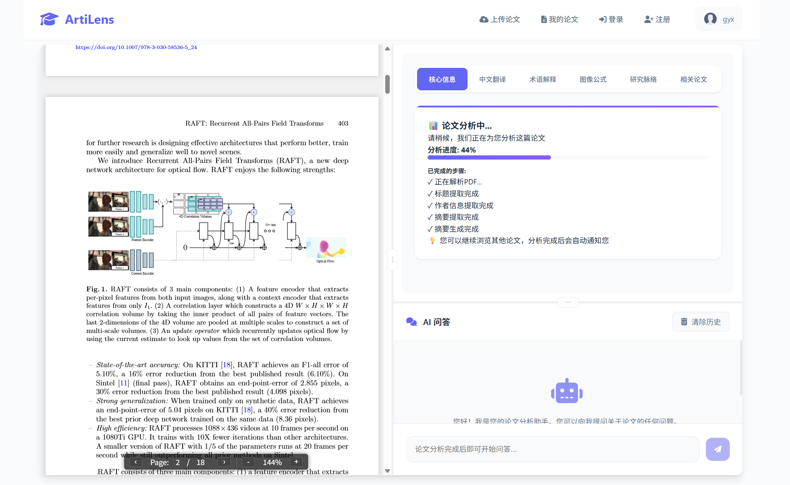

# ArtiLens：智能论文阅读助手

**ArtiLens** 是一个基于大语言模型（LLM）和多模态理解能力的智能论文阅读平台，帮助用户高效解析PDF学术论文，支持交互式翻译、术语解释、图像/公式理解、知识脉络梳理以及智能问答等多项功能。

---

## 🚧 项目状态（2026-10 起重构中）

本仓库正在从"课程实训原型"升级为可产品化的架构，**核心部件正在替换**：

- 去掉 LangChain / LangGraph，改为直连模型 SDK + 类型化 tool loop
- 去掉 `unstructured` + Tesseract + Poppler，改为 PyMuPDF 快路径
- 去掉本地 torch embedding，改为托管 embedding
- Chroma → LanceDB（本地）/ pgvector（目标态）
- 原生 JS 单文件前端 → Vite + React + TS

架构决策记录在 [docs/architecture.md](docs/architecture.md)，是重构期间的唯一权威依据。

- `backend/`：**新后端**（FastAPI + SQLAlchemy 2.0 async），当前处于 S0 阶段，只有健康检查
- `src/`、`node-site/`：**旧实现**，作为领域逻辑（prompt / 引用解析 / 章节归类）的参考保留，S5 之后删除

> 基线快照来自共同开发者仓库 `GYunnnnnX/ArtiLens@19f9a49`（2025-07-25）。本仓库自该快照之后独立演进，不再与其双向同步。

---

## 📸 项目主界面预览




## 项目初衷

阅读英文学术论文存在很多难题，

**ArtiLens** 提供一站式解决方案，聚合多项智能功能，化繁为简。

---

## 🚀 核心功能

-  **PDF 智能解析**：
  - 使用 Poppler + Tesseract 提取文本、公式、图像、表格。
  - 支持图文混排论文解析。

-  **交互式中文翻译**：
  - 支持高亮段落逐句翻译。
  - 上下文提示词增强、流式输出、术语精准翻译。

-  **术语解释与多模态理解**：
  - 支持公式截图、图像注释理解。
  - 调用专门 LLM 实例处理图像/公式/表格。

-  **研究脉络与相关论文扩展**：
  - 基于引用构建 RAG 知识库，动态调用 ArXiv API 拓展论文网络。

-  **问答 Agent 系统**：
  - 支持普通问答 / 绘制流程图 / 思维导图。
  - LangChain ReAct Agent 调用工具链，支持记忆功能。

-  **用户管理系统**：
  - 支持注册、登录、我的论文等用户模块。
  - 聊天历史、论文状态等与用户精确绑定。

---

## ⚙️ 技术架构

- **前端**：
  - `Node.js + Express` 构建响应式界面
  - 使用 `pdf.js` 实现 PDF 渲染与高亮交互

- **后端**：
  - 基于 `LangChain` 搭建问答系统
  - 使用 `SQLite` 存储用户、论文元数据与聊天历史
  - 接入 OCR 工具、ArXiv API、多模态大模型等组件

- **智能 Agent 系统**：
  - 支持动态构建 RAG
  - 使用 Tool Calling 与 Prompt Engineering 技术驱动 Agent 问答

---

## 📂 项目结构

```bash
ArtiLens/
├── backend/artilens/     # 新后端（FastAPI + SQLAlchemy 2.0 async）
│   ├── api/              #   HTTP 层
│   ├── core/             #   配置 / 日志 / 错误
│   ├── domain/           #   实体与端口（实施中）
│   ├── services/         #   用例编排（实施中）
│   └── adapters/         #   db / vector / llm / parsing（实施中）
├── tests/                # pytest
├── docs/architecture.md  # 架构决策
├── src/                  # 旧后端（LangChain），参考用，待删除
├── node-site/            # 旧前端（原生 JS + Express），待删除
├── requirements.txt      # 旧依赖（随 src/ 一起淘汰）
└── pyproject.toml        # 新依赖与工具配置
```

## 🔨  本地运行

1.  **安装Python依赖**：

	进入项目根目录，创建并激活Conda环境，然后安装 `requirements.txt` 中的依赖：

	```bash
	conda create --name ArtiLens python=3.11
	conda activate ArtiLens
	pip install -r requirements.txt
	```


2.  **启动后端服务**：

	```bash
	cd src
	python main.py
	```

	后端服务通常运行在 http://127.0.0.1:8000

	可以通过此链接查看后端网络路由接口 http://localhost:8000/docs


3.  **安装Node.js依赖**：

	进入前端目录 `node-site`，安装 `package.json` 中的依赖：

	```bash
	cd node-site
	npm install
	```

4.  **配置**：

	在.env中配置自己的大模型api密钥。务必确保Poppler和Tesseract的可执行文件路径已正确添加到系统环境变量中。

5.  **启动前端服务**：

	```bash
	node main.js
	```

	前端服务通常运行在 `http://127.0.0.1:3000`。

---

## 🧪 新后端（backend/，S0）

旧流程（`src/` + `node-site/`）仍保留，但新开发一律走 `backend/`。新后端不依赖 Tesseract / Poppler / torch，只需要 Python 3.11+。

```bash
# 1. 创建环境（Windows 示例；已装过可跳过）
python -m venv .venv
.venv\Scripts\activate

# 2. 安装新后端（含 dev 工具）
pip install -e ".[dev]"

# 3. 配置
copy .env.example .env      # 填入 ARTILENS_LLM_API_KEY

# 4. 启动
uvicorn artilens.main:app --app-dir backend --reload --port 8000
```

- 健康检查：<http://127.0.0.1:8000/api/v1/health>
- 接口文档：<http://127.0.0.1:8000/docs>
- 测试与静态检查：

```bash
pytest
ruff check backend
```

